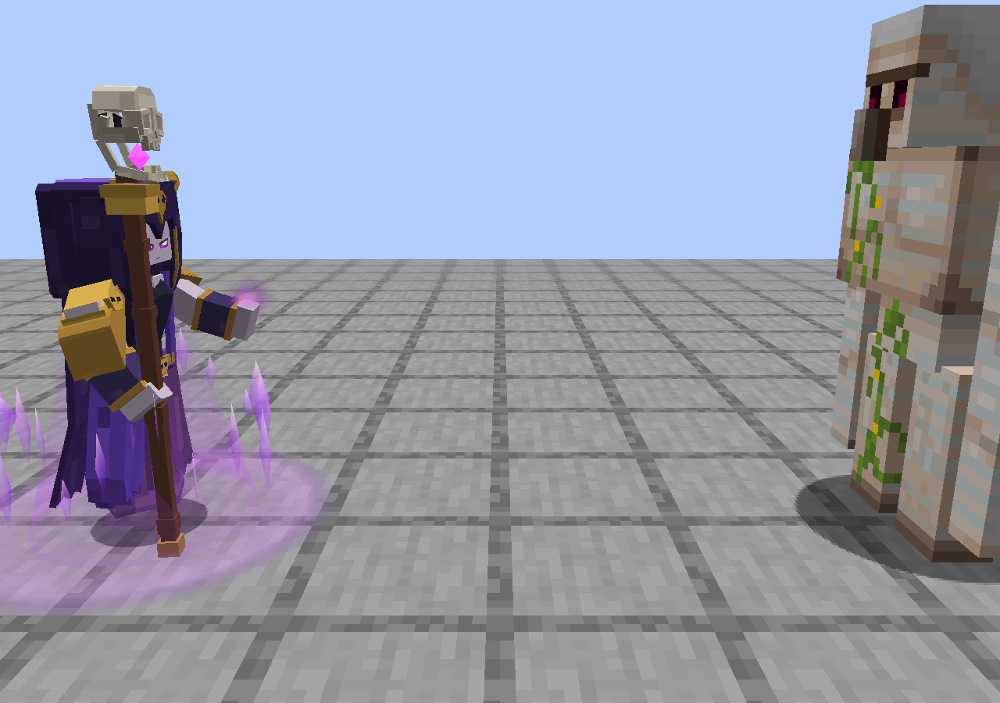
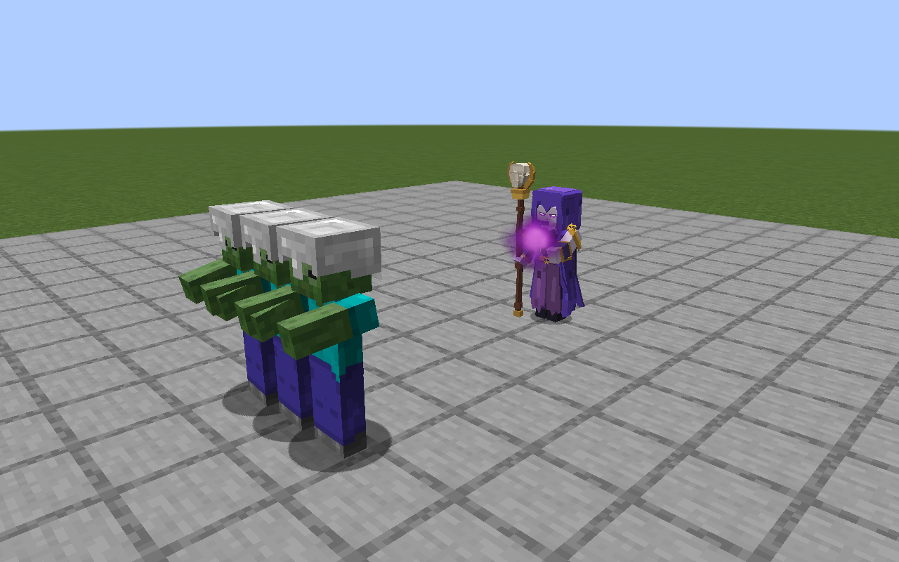
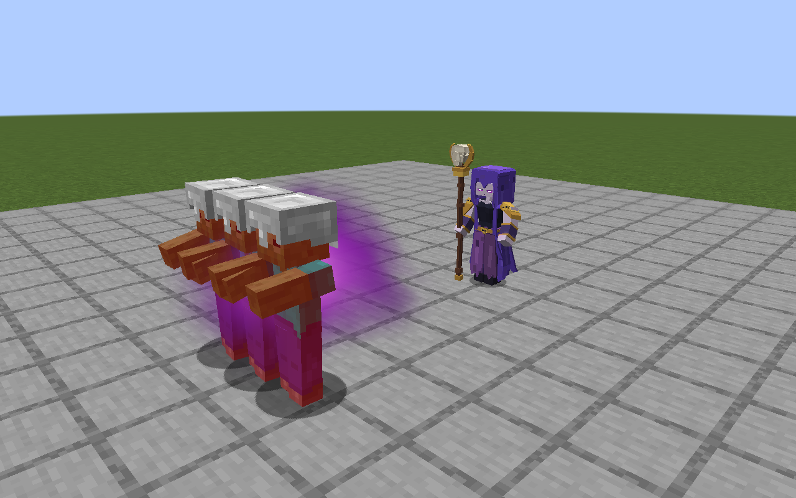
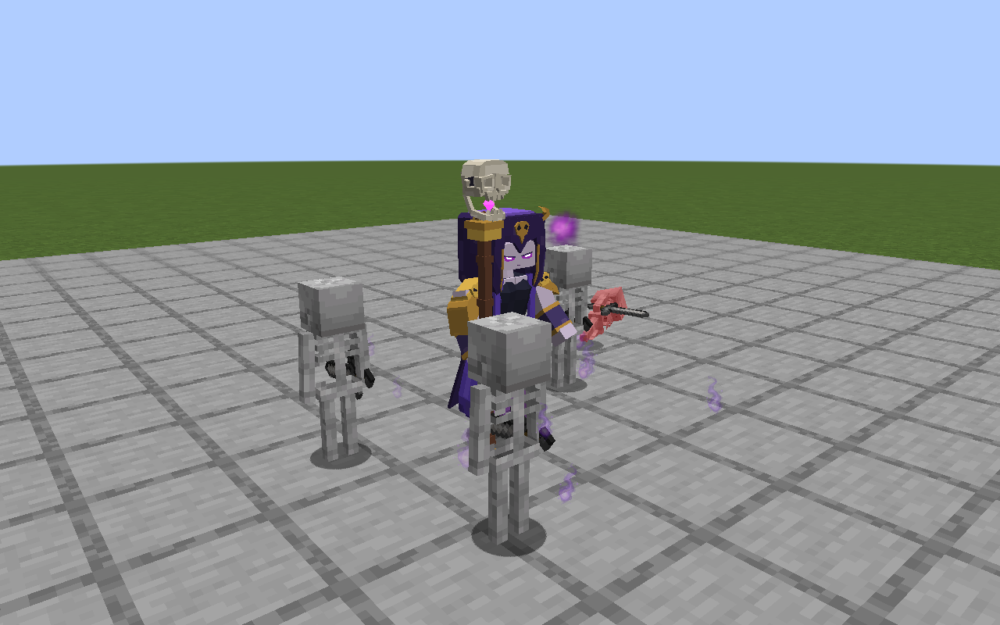
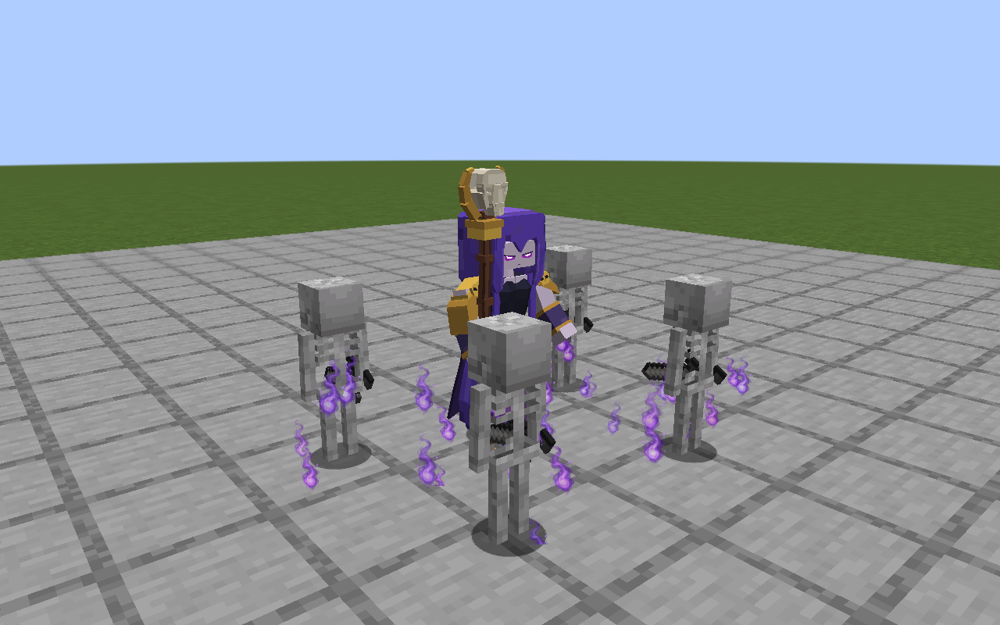
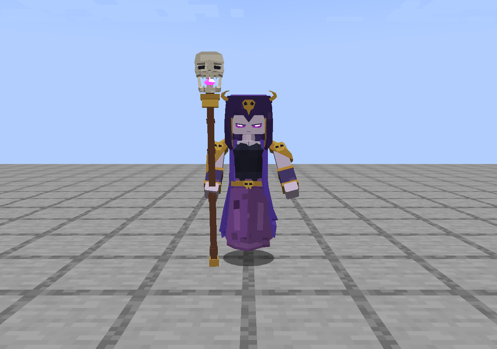

# 16 · 女巫特效交接：分类、源码与 MineClash 接入

本文对应 **Fabric 1.20.1 / Royale Spells 1.9.3** 与 **NeoForge 1.21.1 / Royale Spells 1.9.3-beta.4**，整理日期 2026-10-11。面向希望保留 MineClash 自己的女巫模型、动画与战斗逻辑，只移植这套表现的开发者。

**先看结论：主体攻击使用世界内三维密度场，不是 PNG 序列。** 左掌蓄力、飞行尾雾、命中范围雾、归魂与回血雾均由同一个 GLSL 体积着色器绘制；出土的小粒子、觉醒部署几何和眼睛发光是另外的系统。没有可以把所有效果拖进 GeckoLib 就直接播放的“特效动画文件”。

发布页附 `royale-witch-vfx-handoff-1.9.3.zip`，按共享资源和两个加载器的源码参考分类，并附逐文件 SHA-256、声音配置和许可说明。它是移植资料包，**不是可直接安装的模组或稳定二进制 API**。完整可构建项目请下载对应版本的 source ZIP，或检出下面的分支/标签。

| 项目 | 分支 | 固定发布标签 | 主要区别 |
| --- | --- | --- | --- |
| Fabric 1.20.1 | [main](https://github.com/bendy17323333-lang/royale-spells-fabric/tree/main) | [v1.9.3-fabric-mc1.20.1](https://github.com/bendy17323333-lang/royale-spells-fabric/tree/v1.9.3-fabric-mc1.20.1) | Java 17 字节码；独立卡牌女巫；Mojang official mappings |
| NeoForge 1.21.1 | [iron-integration-1.21.1](https://github.com/bendy17323333-lang/royale-spells-fabric/tree/iron-integration-1.21.1) | [v1.9.3-beta.4-neoforge-mc1.21.1](https://github.com/bendy17323333-lang/royale-spells-fabric/tree/v1.9.3-beta.4-neoforge-mc1.21.1) | Java 21；普通/觉醒卡牌及两枚蛋始终注册；另有可选铁魔法塔内法师；没有女巫卷轴 |

MineClash 1.21.1 应从 **NeoForge 源码**开始。1.9.3 的卡牌女巫、弹体、声音和体积渲染已完全移出铁魔法条件注册。只有 `iron/TowerWitch`、塔结构和世界巡逻单位需要铁魔法。MineClash 应接自己的实体与客户端初始化，不要把可选塔居民继承链一起搬入。

## 1. 特效总目录

`mode` 是 `witch_volume.fsh` 的分支编号，不是网络实体 ID，也不是粒子 ID。所有距离单位为 Minecraft 方块；时间为 tick，秒数仅按正常 20 TPS 换算。

| 分类 / ID | 画面与触发 | 时序 | 实现与调用入口 |
| --- | --- | --- | --- |
| 左掌蓄力 / `charge` | 左手抬起时聚拢的紫雾；右手继续拄杖 | 攻击年龄 1–13；第 14 tick 出弹 | 体积 `mode=5`；`WitchRenderer` 捕获 `left_forearm`，`WitchMagicRenderer.witch()` 收集 |
| 攻击飞行 / `attack_flight` | 明亮内核、较暗外雾、连续空间尾迹 | 出弹后直到命中；最长飞行 80 tick | 体积 `mode=0`；`WitchMagicRenderer.bolt()`；`WitchBolt.KIND=0` |
| 命中范围雾 / `attack_impact` | 从真实碰撞点展开的实心紫雾，随后上浮、变薄、消散 | 命中余效 16 tick，即约 0.8 秒 | 体积 `mode=1`；同步命中点与命中年龄；不是伤害环形区域 |
| 召唤脚边雾 / `summon_fog` | 脚边低矮、流动的紫雾 | `summonAge` 1–24 | 体积 `mode=4`；实体召唤年龄驱动 |
| 骷髅出土 / `skeleton_spawn_motes` | 每只骷髅出生处少量持续上浮的紫色碎光 | 每次实际出生发 9 颗；单颗约 38–65 tick | **Sprite 粒子** `grave_mote`，只作次级细节；不是主体雾的体积来源 |
| 觉醒部署 / `evolution_deploy` | 地面紫色展开、向上收束的带状几何与碎片 | 觉醒女巫首次部署；效果实体存活 24 tick | **世界几何** `EvolutionBurst` + `EvolutionBurstRenderer`；没有使用体积 mode |
| 归魂飞行 / `soul_flight` | 骷髅死亡处飞回母体的小型紫色雾核与短尾迹 | 归魂实体飞行约 20 tick | 体积 `mode=2`；`WitchBolt.KIND=1`；空间弧线由实体提供 |
| 归魂到达 / `soul_arrival` | 到达女巫处的短促扩散，内核带淡绿 | 到达后 16 tick 命中余效 | 体积 `mode=3`，半径参数 0.30 |
| 身体回血雾 / `heal_fog` | 身体上部局部淡绿/紫雾 | `healFlash` 倒计时 10 tick | 体积 `mode=3`，半径 0.32、强度 0.70，局部高度 1.13 |
| 回血闪色 / `heal_tint` | 模型短暂偏淡绿，恢复原色 | 倒计时大于 5 时染色，大于 6 时提高 packed light | `TroopModel` 与 `WitchRenderer`，不是全屏滤镜 |
| 眼睛发光 / `eyes` | 当前模型中标为 emissive 的网格 | 随模型姿态连续绘制 | `WitchRenderer` 的模型附加层 → `TroopModel.renderEmissive()` |
| 控制状态表现 / `control_feedback` | 冰冻/电击暂停角色动作，雪球减速和蓝色反馈 | 使用各状态的现有生命周期 | 共用 `AnimationTimeline`、`FrozenRender` 等；见第 8 节边界 |

普通和觉醒女巫共用攻击雾的基本紫色色系。目前虽然参数 `Shape.z` 传入了 evolved 标志，**片元着色器并没有读取它**；不要仅设置这个标志就期待攻击自动换色。觉醒区别主要体现在部署、归魂、回血、模型和原作声音。

## 2. 对照画面与证据

以下图片直接取自本版 Minecraft 客户端捕获，没有用概念图替代。完整时序帧、日志和统计在每个发布页的 validation-evidence ZIP；静态图片不能证明所有帧都顺滑或某台机器的 FPS。

| 左手蓄力（NeoForge） | 飞行雾体（Fabric） |
| --- | --- |
|  |  |

| 命中展开（Fabric） | 归魂（Fabric） |
| --- | --- |
|  |  |

| 召唤（Fabric） | 觉醒悬空袍摆（NeoForge） |
| --- | --- |
|  |  |

## 3. 源码和资源怎样分工

以下链接指向当前分支。两个版本同名类承担相同职责，但加载器回调、矩阵入口和 BufferBuilder API 不可混抄。

| 文件 | 要复用的部分 | 移植时要改的部分 |
| --- | --- | --- |
| [WitchMagicRenderer.java](../../src/main/java/dev/royalespells/client/WitchMagicRenderer.java) | 模式参数、连续尾迹、命中接缝、按距离选择和排序 | Fabric RoyalWitch / NeoForge WitchActor / WitchBolt 类型、实体枚举、计时/数据访问器、模型锚点类型 |
| [WitchVolume.java](../../src/main/java/dev/royalespells/client/WitchVolume.java) | 深度复制、代理盒、uniform、LOD、GL 状态恢复 | 命名空间、注册入口；需要跨包调用时调整可见性 |
| [witch_volume.json](../../src/main/resources/assets/royalespells/shaders/core/witch_volume.json)、[vsh](../../src/main/resources/assets/royalespells/shaders/core/witch_volume.vsh)、[fsh](../../src/main/resources/assets/royalespells/shaders/core/witch_volume.fsh) | 三维密度函数、形变、光学积分及各模式 | JSON 中 vertex/fragment 资源命名空间一起更改；uniform 名称与 Java 必须一致 |
| [WitchRenderer.java](../../src/main/java/dev/royalespells/client/WitchRenderer.java) | 本帧真实左掌矩阵、短暂回血亮度、眼睛层 | 改为 MineClash 模型/GeckoLib 对应的左手骨骼矩阵 |
| [TroopModel.java](../../src/main/java/dev/royalespells/client/TroopModel.java) | 左手施法姿态曲线、模型染色与 emissive 网格示例 | 不要为特效强制替换 MineClash 模型系统；把所需挂点与附加层移到它的 renderer |
| [WitchBolt.java](../../src/main/java/dev/royalespells/entity/WitchBolt.java) | 同步字段、插值、真实命中点、归魂轨迹的完整参考 | 可替换成 MineClash 自己的弹体和事件；伤害逻辑继续由 MineClash 服务端负责 |
| [RoyalWitch.java](../../src/main/java/dev/royalespells/entity/RoyalWitch.java) | 触发顺序、攻击/召唤/回血年龄、声音的时机 | 不必继承该实体；两版卡牌均不依赖铁魔法。NeoForge 的共享实现位于 `entity/WitchBehavior.java`，`iron/TowerWitch.java` 才继承铁魔法法师 |
| [EvolutionBurst.java](../../src/main/java/dev/royalespells/entity/EvolutionBurst.java)、[EvolutionBurstRenderer.java](../../src/main/java/dev/royalespells/client/EvolutionBurstRenderer.java) | 部署特效的生命周期、环带/柱带/碎片 | 注册自己的纯视觉实体或等价客户端事件；保留同步位置、半径、年龄 |
| [GraveMoteParticle.java](../../src/main/java/dev/royalespells/client/GraveMoteParticle.java) | 出土碎光运动、透明度、尺寸曲线 | 注册自己的粒子类型和 provider |
| [grave_mote.json](../../src/main/resources/assets/royalespells/particles/grave_mote.json)、[grave_mote.png](../../src/main/resources/assets/royalespells/textures/particle/grave_mote.png) | 辅助粒子定义与透明贴图 | 粒子 JSON 内的贴图 namespace 也要改 |
| [WitchSounds.java](../../src/main/java/dev/royalespells/WitchSounds.java)、[sounds.json](../../src/main/resources/assets/royalespells/sounds.json) | 11 个女巫事件，映射 12 份唯一 OGG | 只合并女巫条目，不能覆盖 MineClash 整张 sounds.json |

可编辑女巫工程在 [witch.bbmodel](../../art/blockbench/witch.bbmodel)、[witch_evolution.bbmodel](../../art/blockbench/witch_evolution.bbmodel)。运行时是本项目自定义 `models/troop/*.json`，**不是 GeckoLib geo.json**。交接包将这些列为可选的骨骼/挂点参考，不要求伙伴放弃自己的美术。

机器可读文件目录、哈希及许可分类见 [witch-vfx-manifest.json](witch-vfx-manifest.json)。完整源包包含上述类依赖的注册、状态、战斗、测试等代码；轻量交接包的 `source-reference/` 是按职责摘出的原文件，不能独立编译。

## 4. MineClash 接入顺序

1. 在客户端包注册一个体积效果管理器，先接通 `WitchVolume` 的 shader 加载、深度目标和世界绘制阶段。重命名资源命名空间及 JSON 引用；保留 GLSL uniform 契约。
2. 将 `WitchMagicRenderer` 中的 `instanceof RoyalWitch/WitchBolt`（Fabric）或 `WitchActor/WitchBolt`（NeoForge）、强类型 WeakHashMap 和方法参数，替换为 MineClash 对应实体或一个只读的状态适配层。不能只注册 EntityRenderer 就结束：主体效果由世界回调统一收集。
3. 先用 MineClash 的普通攻击弹体接通 `mode=0` 和 `mode=1`。供给连续位置、tick/partial、碰撞点和命中年龄；保持客户端渲染不造成伤害。
4. 在 MineClash 女巫的**左手骨骼完成当前帧动画之后**捕获矩阵，再接 `mode=5`。先检查第一发，再检查连续攻击、转身、冰冻与离屏重入；模型 pivot 不同就重新标定局部偏移。
5. 将召唤动作开始事件接到 `summonAge`，真正出生事件接到 grave_mote 与召唤声音。脚边雾只演出，不生成骷髅。
6. 如果伙伴版具有觉醒归魂机制，依次接归魂起点、目标母体、到达事件，再接 `mode=2/3` 与 healFlash。没有该机制时可暂不启用，不要让 shader 自己决定治疗。
7. 接部署几何、眼睛层和声音。最后再把控制状态接入 MineClash 自己的每实体动画时钟。
8. 按第 11 节逐项在真实客户端检查；只在体积渲染正常后才调整颜色、噪声或光学参数。

**当前没有现成的跨模组调用接口。** `WitchVolume` 和 `Volume` 在源码里是包可见；原收集器只接受本项目实体。NeoForge 的 `WitchAppearance` 仅给模型读取外观/年龄；当前收集器认 `WitchActor`，后者同时暴露本项目 `WitchBehavior`，不建议伙伴为借用特效强行实现整套战斗接口。应改成自己的只读状态适配层。本次交付未替 MineClash 实施或实测移植。

### 建议的状态适配契约（设计示例，不是仓库已有 API）

伙伴可以自定义如下只读字段，避免视觉层继承本项目全部 AI。具体方法名按自己的实体实现；不要把下面的名称当成已存在可调用的方法。

```text
WitchVisualState:
  entityKey, evolved, attackAge, summonAge, healFlash
  interpolatedWorldPosition(partial), currentLeftPalmMatrix

BoltVisualState:
  entityKey, kind(0=attack,1=soul), evolved
  tickCount, interpolatedWorldPosition(partial)
  impacted, impactAge, confirmedImpactWorldPosition, impactNormal
  impactRadius, flightDirection
```

世界渲染只读这些状态。服务端负责什么时候生成/命中/召唤/治疗；网络把结果同步到客户端。按实体隔离尾迹与动画数据，不用一个 static “当前女巫”保存状态。切换世界、退出服务器时清空缓存。

## 5. 六个体积模式的参数与使用

以下数值是本版本源码默认表现参数，不是通用美术标准，也不是服务器伤害表。

| mode | 包围盒 / 半径 | phase 与 strength | 特别说明 |
| --- | --- | --- | --- |
| `0` 攻击飞行 | 核半径 0.34；边缘余量 0.58，并包含尾迹；尾迹最长 2 格 | 飞行阶段由连续时间驱动 | 7 个等弧长尾迹节点；不要只把一个球沿直线移动 |
| `1` 攻击命中 | r=`min(1.7, impactRadius)`；当前 r=1.5；边界约 ±`(r*1.55+0.24)` | `phase=impactTime/16` | 外围装饰雾比伤害半径宽；不要让视觉包围盒决定伤害 |
| `2` 归魂飞行 | 核半径 0.18；边缘余量 0.33；尾迹最长 1.2 格 | 归魂连续时间 | 轨迹来自实体，shader 只扰动雾，不改变实际到达判定 |
| `3` 到达/回血 | 到达 r=0.30；模型回血 r=0.32，边界 ±0.5 | 到达用 impact phase；身体用 `1-clamp((healFlash-partial)/10)`、strength=0.70 | 同一个 mode 有两个独立触发源，不要重复执行治疗 |
| `4` 召唤 | min=(-1.1,-0.1,-1.1)，max=(1.1,0.75,1.1)，r=0.72 | p=`(summonAge-1+partial)/24`；strength=`clamp(p*5)*clamp((1-p)*3)*0.65` | 低矮雾区，按生命周期渐入渐出 |
| `5` 左掌蓄力 | r=`0.07+0.14*p`，边界约 ±`r*1.65` | p=`clamp((attackAge+partial)/14)`；strength=`0.22+0.65*p` | 只在年龄 1–13 且本帧捕获到了手掌时绘制 |

### 时间、空间和 uniform

`Volume.pose` 是 **体积局部空间到 view-space** 的矩阵。`min/max/trail` 都在该局部空间，不能一个传世界坐标、另一个传相机坐标。`time` 是带 partial 的 tick 时间；`phase` 是 0–1 生命周期。`distance` 字段实际保存**距离平方**，不是格数。

| uniform | 类型 | 内容 |
| --- | --- | --- |
| `Projection` / `InverseProjection` | mat4 | 本帧投影及逆矩阵 |
| `VolumeToView` / `ViewToVolume` | mat4 | 本体积局部/view 变换及逆矩阵 |
| `TargetSize` | vec2 | 实际 FBO 像素尺寸，不能用 GUI 缩放后的宽高 |
| `BoundsMin` / `BoundsMax` | vec3 | 局部包围盒 |
| `Params` | vec4 | mode、连续时间、phase、strength |
| `Shape` | vec4 | 半径、积分步数、evolved 标志、尾迹节点数；evolved 当前不参与 fragment 分支 |
| `Tail0` … `Tail6` | vec4 | 局部节点 xyz + 尾部宽度参数 |
| `SceneDepth` | sampler2D | 单独复制出来的场景深度纹理 |

不要随意把 `SceneDepth` 改名 `Sampler0`：Minecraft 即时绘制会写默认 sampler。也不要把所有体积加入一个延迟执行的共享 RenderType 后反复修改同一 shader uniform，后一个实体会覆盖前一个实体的参数。本实现设置一个体积的参数后立即提交该次 draw。

## 6. 渲染原理与加载器差异

### 三维形状怎样产生

每个体积有一个向外绕序的闭合六面代理盒，只光栅化退出表面。代理盒不显示纹理，也不是可见的魔法方块。fragment shader 在盒内求射线进入/退出位置，逐步采样**三维连续密度场**。

内核、外雾、尾迹分别有不同包络；低频形变与连续三维噪声随时间平移和扭动，避免每帧重新随机导致闪烁。命中是从中心展开的实心雾团，随后上浮、降低中心能量并透明消散。默认边缘色约 (0.18,0.025,0.30)、中间色 (0.67,0.15,0.80)、内核色 (0.97,0.57,0.94)，归魂到达带 (0.70,0.94,0.69)。不是几张白色贴图叠加。

每步 `sampleAlpha=1-exp(-density*stepLength*4.3)`，按剩余透射率从前向后积累；最终颜色除以 alpha，输出直通 RGB，再用普通 `SRC_ALPHA / ONE_MINUS_SRC_ALPHA` 合成。没有依赖加法高曝光或 Bloom。将已经预乘的颜色再用这套普通混合会变暗，不能只改一半。

### 遮挡与 GL 状态

在体积 pass 开始前提交普通 buffer；每帧只复制一次主目标深度到独立 `TextureTarget`。不能边渲染主 FBO 边采样它自己的深度附件。复制后重新绑定主目标。

通过逆投影和逆体积矩阵，把 SceneDepth 恢复到局部空间；积分终点不能穿过场景表面，并有 0.055 格的软交界。代理 draw 不写深度，不会留下透明面把后面的玩家“切掉”。代理表面关闭普通深度测试，实际遮挡由深度采样裁剪实现。

`finally` 恢复 draw/read FBO、viewport、深度 test/write、cull 模式、blend 函数/方程、着色器、纹理单元 0 绑定以及先前 active unit。相机进入体积、窗口 resize、资源重载和切换世界都需要正确释放/重建深度目标。

| 入口 | Fabric 1.20.1 | NeoForge 1.21.1 |
| --- | --- | --- |
| 安装 | 客户端调用 `WitchMagicRenderer.install()` 一次 | 客户端调用 `WitchMagicRenderer.install(modEventBus)` 一次 |
| Shader | `CoreShaderRegistrationCallback` | `RegisterShadersEvent`，**MOD event bus** |
| 每帧清除手掌锚点 | `WorldRenderEvents.START` | `RenderLevelStageEvent.AFTER_SKY`，NeoForge event bus |
| 体积绘制 | `WorldRenderEvents.LAST` | `RenderLevelStageEvent.AFTER_LEVEL` |
| 世界矩阵 | 回调 matrixStack 已有相机旋转，位置减 camera 一次 | 新 PoseStack 后乘 event.getModelViewMatrix()，位置减 camera 一次 |
| 左掌矩阵 | 保存实体当前 pose 的副本 | 保存 `RenderSystem.getModelViewMatrix() * 实体pose` 的副本 |
| partial | context.tickDelta() | event.getPartialTick().getGameTimeDeltaPartialTick(false) |
| 顶点提交 | 1.20.1 BufferBuilder begin/end API | ByteBufferBuilder + 1.21.1 BufferBuilder/addVertex/buildOrThrow API |
| 释放 | 客户端停止回调 | LoggingOut 及 shader/目标重建路径 |

NeoForge 原代码通过 `TargetPreview.matrices(event)` 构造矩阵；移植时只需提取其中的 AFTER_LEVEL 矩阵处理，不必把整套准星一起搬过去。Fabric 不要额外再乘一次 RenderSystem 的旋转，否则转视角时特效会偏移或消失。

客户端渲染类不得被 dedicated server 初始化；粒子/实体/声音的服务端注册与 shader/renderer 的客户端注册分开。NeoForge 的 mod bus 和全局游戏 bus 不可交换。

### 性能预算

- 72 格距离裁剪，实体包围盒外扩 3 格做 frustum 检查。
- 先选最近 40 个可见体积，再倒序进行透明合成；不能先选最远 40 个。
- 12 格内 36 步，26 格内 26 步，远处 18 步；减少粒子设置再降 8 步，最低 14。shader 循环上限 40。
- 估计覆盖像素 × 积分步数，约 1300 万软预算后降到 14 步；约 2600 万硬预算后跳过超过 18 格的体积。这是预算估算，不是 GPU 计时。
- 透射率低于 0.015 提前停止；最终 alpha 小于 0.003 的片元丢弃。
- 一帧一次深度复制，不是每只女巫复制一次；尾迹每实体至多 96 个点。

改变画面分辨率、实体数量或重叠面积会显著改变开销。关闭 Bloom 后仍有形状是设计要求；与任意光影包兼容、具体 FPS 或大规模多人稳定性不能由本次资料包保证。

## 7. 左手、出弹点与帧间连续性

### 左掌挂点

本版角色是**右手拄杖、左手施法**。在本项目模型完成 setupAnim 后的附加层里执行：

```java
// 原项目的真实调用片段；移植到 MineClash 时替换 bone/matrix API。
pose.pushPose();
if (model.transformToJoint("left_forearm", pose)) {
    pose.translate(0, 4 / 16f, -2 / 16f);
    WitchMagicRenderer.chargeAnchor(witch, new Matrix4f(pose.last().pose()));
}
pose.popPose();
```

偏移 `(0,4/16,-2/16)` 只对本模型成立。GeckoLib 模型应在其骨骼已经应用动画的渲染阶段读取左手的完整父子变换；把 `bone.getPivot()` 当作世界坐标会错。旧 shader 里“Staff generation”的注释是历史命名，不代表当前挂在杖顶。

本项目服务端 muzzle：`position + (0,1.382,0) + forward*0.548 + (forward.z*0.344,0,-forward.x*0.344)`。forward 是水平朝向，单位格；从身体高度点到 muzzle 仍检查方块遮挡。MineClash 若改变比例/持杖姿态，需要同步标定自己的发射点，不应直接抄固定数值。

攻击周期 22 tick，其中 14 tick 释放，8 tick 收手；左手动作采用平滑过渡。右臂/前臂/法杖保持支撑姿态，召唤抬手按 `(1-cast)` 衰减，避免两种动作同时叠加把手推离出口。本项目在施法渲染期间暂时对齐身体与攻击朝向，并在 finally 恢复实体字段；不要用渲染层永久修改伙伴的寻路/服务端朝向。

### 飞行、命中与网络

`WitchBolt` 同步 KIND、AGE、IMPACT、EVO、START、DIRECTION、NORMAL、IMPACT_POINT。命中标志和确认碰撞点一起同步；服务端判定一次，客户端不因视觉碰到方块再次造成伤害或播音。

客户端 `lerpTo` 将位置排队，客户端 tick 推进短插值，再用 partial 连续显示。尾迹取**实际渲染位置**，按弧长重采样成 7 节。离屏间隔超过 2 tick、世界切换或大幅跳跃时清旧尾迹，避免跨地图拉长条。

收到命中后只校准一次 `impactStart=time-max(0,impactAge-1)`，之后用单调时间推进；不能每一帧用不同步的网络整数年龄重新起算。若最后 GPU 绘制位置还落后确认命中点超过 0.025 格，就用实际末段速度作 Hermite 接缝补程，时长限制 0.12–2 tick；命中时钟继续运行，服务端伤害、声音和实体寿命不延后。否则核心会瞬移到爆点，或 impact phase 在 tick 边界倒退。

MineClash 的弹体如果命中当帧立即 discard，需另存客户端命中效果的有限生命周期，或保留纯视觉实体约 16 tick；不能让伤害实体在客户端消失时顺带清掉全部命中余效。不要为保留画面重复运行命中伤害。

## 8. 召唤、觉醒部署和回血

### 召唤与粒子

`summonAge` 是一次动作的年龄，不是女巫从出生起的年龄。本项目每 140 tick 发起一轮召唤，视觉动作 24 tick；伙伴的玩法可保留自己的频率，只需在每轮事件开始时重新触发视觉年龄。

每只骷髅实际生成时，在出生位置 y+0.08 发送 9 个 `grave_mote`，spread=(0.25,0.16,0.25)，speed=0.02。粒子由独立紫色素材产生，寿命随机 38–65 tick，尺寸约 0.14–0.29，缓慢上浮、阻尼与透明度衰减。它是面向镜头的 sprite；只是有空间分布的次级碎光，不能冒称真正体积雾。

复制 provider、注册 SimpleParticleType、添加 `particles/grave_mote.json` 和 `textures/particle/grave_mote.png`，并修改 JSON namespace。不要替换为末影粒子，也不要在服务器和客户端各生成一遍导致数量翻倍。

### 觉醒部署

原项目可调用 `EvolutionBurst.deploy(ServerLevel, Vec3, float radius)`，女巫部署使用 radius=1.2，合法值钳制 0.5–3。它引用本项目已注册的 EVOLUTION_BURST entity type；搬到 MineClash 后必须换成自己的注册对象或等价同步事件。

渲染由 32 段收束柱带、80 段地面环带和 20 片定向碎片组成，生命 24 tick；这些是世界透明几何，其中碎片是 quad，**与体积射线积分是两套实现**。效果不造成伤害，不应阻挡移动或写入深度。

Fabric 在 `RoyaleClient.fields()` 的 AFTER_TRANSLUCENT 阶段调用；NeoForge 对应 AFTER_PARTICLES。保持相机相对矩阵和 EFFECT buffer 提交。若宿主选择单独的普通 EntityRenderer，就不要还在 world pass 重复画一遍。

### 归魂与回血

本项目只有觉醒女巫首波四只符合条件的非克隆骷髅能返回灵魂；死亡去重由服务器台账负责。归魂从死者 y+0.65 出发，目标女巫 y+1.3，中段增加 `sin(fraction*pi)*0.7` 的高度，20 tick 到达。到达后才治疗并设置 healFlash；不是刚死亡就直接回血。

移植画面时只需把相应状态传给 mode=2/3。如果 MineClash 的设计不同，应保留其机制；不要复制 renderer 后让它顺便调用 heal。模型短闪在 healFlash>5 使用 RGB=(0.82,1,0.89)，每次 setupAnim 先恢复中性颜色，避免其他女巫/其他实体继承上一只的绿色。眼睛的附加绘制层也要遵循各实体独立姿态。

### 冰冻、电击和雪球

角色动画使用每实体 AnimationTimeline，冰冻/电击暂停，雪球状态减速；服务器动作年龄与攻击释放同样受状态控制。本版体积流动时间仍由各实体 tickCount+partial 驱动，**不等于所有雾体噪声也会完全冻结**。若伙伴希望同步冻结雾的流动，需要另传有效视觉时钟，不可用共享 static 变量暂停整类实体。

不要把某一只女巫的骨骼姿态保存进共享模型后让下一只直接继承。每次渲染重置姿态、每实体缓存暂停时钟；实际遇到的跨实体死亡/攻击姿势污染正是需要防止的回归。相关背景见 NeoForge 技术档案的 [电击与动画暂停](https://github.com/bendy17323333-lang/royale-spells-fabric/blob/iron-integration-1.21.1/docs/technical/13-electrical-pause.md)。

## 9. 原作声音：事件、时机和许可

共 **11 个事件 / 12 份唯一 OGG**。交接包给出可直接合并到自己 namespace 的 sounds.json 女巫子集，以及中英文字幕子集。只合并条目，不覆盖整份 MineClash 配置。所有声音路径前缀为 `witch/`；下面省略 `.ogg`。

| 事件 ID | OGG 文件 | 服务端触发 | 调用音量 |
| --- | --- | --- | --- |
| `witch_deploy` | summon_witch_01 | 普通女巫部署 | 0.62 |
| `witch_attack` | witch_attack_02 | 普通女巫出弹 | 0.46 |
| `witch_impact` | card_evolution_witch_attack_hit | 普通法球命中 | 0.52，sounds 条目另乘 0.55 |
| `witch_summon` | witch_summon_02 | 普通骷髅召唤 | 0.52 |
| `witch_heal` | card_evolution_witch_healing | 灵魂到达、回血 | 0.48 |
| `witch_death` | npc_die_02 | 死亡 | 实体死亡声音路径 |
| `evolved_witch_deploy` | card_evolution_witch_deploy_sfx | 觉醒部署音效 | 0.62 |
| `evolved_witch_deploy_voice` | card_evolution_witch_deploy_vo_01 或 _02 | 与觉醒部署音效同时触发，一次随机选一个语音 | 0.52 |
| `evolved_witch_attack` | card_evolution_witch_attack | 觉醒出弹 | 0.46 |
| `evolved_witch_impact` | card_evolution_witch_attack_hit | 觉醒法球命中 | 0.52 |
| `evolved_witch_summon` | card_evolution_witch_skill_skeleton_01 或 _02 | 觉醒召唤，一次随机选一个 | 0.52 |

注册使用 fixed range 48 格，声音条目也设 attenuation_distance=48，SoundSource.HOSTILE、pitch=1。音效由服务端 playSound 广播一次；客户端不要因看到某个动画年龄又重播。48 格是传播范围参数，并不保证在任意玩家音量/声源距离都一样响。

原始立体声被转为单声道 Vorbis（用于距离衰减），没有变速、变调或混入 Minecraft 声音。普通命中明确复用觉醒命中素材并调低配置音量；死亡用该分类的共享 `npc_die_02`，不是伪称独有语音。未确认专用受伤语音，因此不拿其他角色的声音补齐。

逐文件来源、原始/安装后哈希及转换信息见 [WITCH-ASSET-SOURCES.json](../../WITCH-ASSET-SOURCES.json)。原作声音归 Supercell；公开解包地址不是再许可，**不属于本项目 MIT 代码许可**。

## 10. 调整什么、不要混淆什么

| 想调整 | 修改位置 | 同时检查 |
| --- | --- | --- |
| 内亮外暗、紫雾层次 | fsh 中颜色、density/core 包络 | 不要靠白色加法混合掩盖层次；关闭 Bloom 检查 |
| 飘动速度和不规则轮廓 | fsh 的连续时间形变与噪声坐标 | 不改服务器轨迹；避免用每帧随机数 |
| 尾迹长度/宽度 | WitchMagicRenderer 的 trail 重采样、radius 与 fsh 衰减 | 包围盒要覆盖新尾迹，瞬移要清缓存 |
| 命中展开大小 | impactRadius 对应体积参数与 bounds | 伤害半径另由服务端确定；不能只改 shader 就宣称判定扩大 |
| 出手位置 | 自己模型的左手挂点 + 服务器 muzzle | 四个朝向、转身第一发、近墙发射 |
| 命中持续时间 | 视觉状态寿命和 phase 分母 | 客户端与服务器 discard 的关系；不能播放半截 |
| 出土碎光 | GraveMoteParticle 与粒子资源 | 它是次级 sprite，不用它替代主体体积 |
| 音量/传播 | 服务端调用 volume、sounds.json、fixed range | 不重复广播，不把立体声当可定位声音 |
| 性能 | 体积上限、LOD、预算、frustum | 同场景同分辨率测量；优先降低远处成本 |

第三方角色设计和素材权利不因网格转换或 OGG 重编码而消失。自编 Java/GLSL、配置、工具和本文使用 MIT；本项目能授予的独立新素材贡献按 ASSETS.md 说明处理；原作卡图、音频、MineClash 改编资产和原作角色设计明确排除。交接包保留 [LICENSE](../../LICENSE)、[LICENSE-NOTICE.md](../../LICENSE-NOTICE.md)、[ASSETS.md](../../ASSETS.md) 和各来源清单。

## 11. 实际接入验收与已验证范围

**本版验证入口：** [1.9.3 验证记录](../../VALIDATION-1.9.3.md)。Fabric：51 项 GameTest，实际成品 JAR 客户端 62 张时序/多角度截图，1721 个 GPU 提交时的连续位置/时间样本。NeoForge：110 项独立与 183 项铁魔法同装 GameTest；另运行无铁魔法卡牌客户端及同装塔居民客户端。测试同时检查生存模式真正右键使用卡牌和刷怪蛋，不只直接调用召唤方法。

前期失败/超时也保留在验证记录中。图形检查的 NeoForge 环境是 ModDev 客户端；这些统计不代表用户 CurseForge 实例验收，也不是 FPS 基准。**尚未验证：MineClash 改造后的接入、任意光影、所有自然塔种子、各种多人延迟组合。**

伙伴完成接入后，至少逐项检查：

1. 单只普通/觉醒女巫：正面、侧面、背面、45 度；蓄力确实在左掌，第 14 tick 出弹，无杖顶残影。
2. 朝东南西北与转身第一发；快速旋转镜头，模型离屏后回来。没有错误矩阵偏移、旧挂点或跨地图尾迹。
3. 飞行、命中前后、展开中期、消散末期分别观察。命中位置不跳跃，连续 phase 不在 tick 边界倒退。
4. 在墙前、台阶旁、实体后方和相机进入雾体时观察。雾不透实心墙，也不裁掉玩家/女巫模型；盒面不可见。
5. 两只女巫错开攻击：一只受冰冻、电击或雪球影响时，另一只不能停住、染色或继承攻击姿势。
6. 召唤只在实际出生处发粒子；觉醒部署只播一次；归魂到达后才触发声音/模型闪色，客户端不重复治疗。
7. 多人服务端验证一次攻击只造成一次伤害、一次服务器声音广播。离开/重进世界无旧雾残留。
8. Fast/Fancy/Fabulous、窗口缩放、F3+T 资源重载；再单独测试准备支持的光影和渲染优化模组。
9. 固定相机、分辨率、画质与实体数做无效果/有效果对比，记录 FPS/GPU frame time；不要用 GameTest 或静态图代替性能验收。

日志 `WITCH_VOLUME_SHADER_READY` 表示 shader 已加载；`WITCH_VOLUME_ACTIVE` 才表示发生实际 draw。两者都不等于美术验收完成。若模型显示但雾完全不出现，依次查：是否误抄了旧版铁魔法条件、世界收集器是否识别宿主实体、事件 bus/阶段、shader namespace、客户端注册、矩阵、深度目标与 frustum。

## 12. 交接包目录

```text
royale-witch-vfx-handoff-1.9.3/
  README.md                         快速使用和版本边界
  docs/                             本文、两版 manifest、原始客户端示例帧
  shared/assets/royalespells/        shader、grave_mote、女巫音频
  shared/sounds.witch.json           仅女巫声音条目
  shared/lang/*.witch.json           仅上述声音的字幕条目
  source-reference/fabric-1.20.1/    Fabric 原文件（不是独立工程）
  source-reference/neoforge-1.21.1/  NeoForge 原文件（不是独立工程）
  model-reference/                   可选 bbmodel、运行网格、图集
  provenance/                        两版来源与许可范围
  manifest.json                      包中逐文件用途、SHA-256 与许可类别
  SHA256SUMS.txt                      除自身外全部文件校验
  LICENSE
  LICENSE-NOTICE.md
```

ZIP 内源码保持发布基线原样，避免文档示例和真实实现互相漂移；最终完整依赖、构建与测试以对应完整 source ZIP 为准。仓库技术章节的相对源码链接应在完整项目中打开；轻量包中按 `source-reference/<loader>/` 的相同路径定位。
