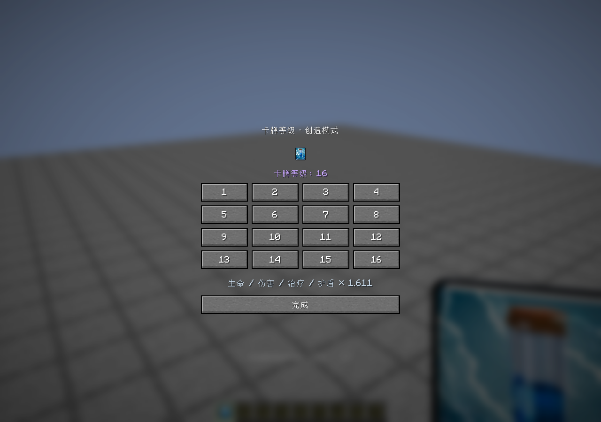
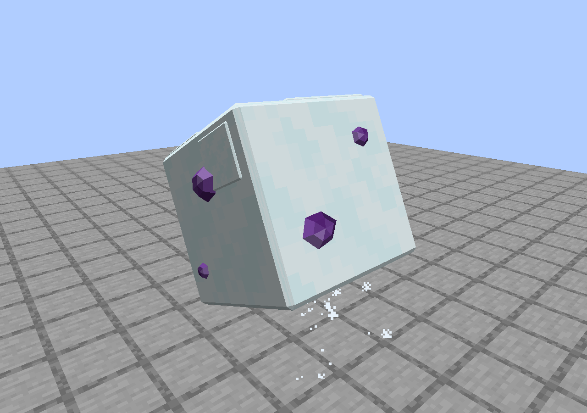

# 18 · Beta 5：卡牌等级、MineClash 卡面、虚空声音与觉醒雪球

适用版本：`1.9.4-beta.5`，Minecraft 1.21.1 NeoForge。Fabric 1.20.1 的已发布 1.9.3 不会因本分支发布自动获得这些功能。

## 玩家入口和数值约定

创造模式拿着一张本模组独立卡牌，按 **G** 打开等级选择，选择 1–16 级后按“完成”。按键可在控制设置中更改。优先编辑主手，主手不是本模组卡牌时编辑副手；命令只编辑主手：

```mcfunction
/royalespells level 1
/royalespells level 11
/royalespells level 16
```

创造模式玩家无需 OP 可改自己的卡；生存玩家须有 2 级命令权限。`give`、`refill`、`clear`、`scene` 仍然要求管理员权限。此版没有新增生存升级配方，也不改卡牌的既有获取流程。



以原有 11 级数值为基准，`数值(L) = 数值(11) × 1.1^(L−11)`。这是根据用户要求从固定基准推算的连续比例，不声称逐级复刻原作取整表。保留小数参与计算，显示时才取整。1 级系数约 0.385543，11 级为 1，16 级为 1.61051。

缩放生命、基础攻击、治疗、护盾和觉醒女巫归魂上限。半径、射程、持续时间、控制时间、数量、攻击/召唤间隔、冷却、移动速度及圣水花费不随等级变化。克隆保留 Minecraft 的 1 HP 下限。已有旧卡无等级标签时默认 11 级，旧世界中的 11/12 级实体继续读取其保存值；不是把所有旧召唤物重新满血初始化。

镜像保留上一张成功使用卡的种类和觉醒身份，使用**镜像自身等级 + 1**，最高内部 17 级，而不是永远固定 12 级。觉醒飞桶的两个实体、墓园骷髅、小屋后续产兵、女巫子兵和诅咒转化继承释放瞬间的等级。玩家之后换卡或改等级不会影响已存在的效果。

## 代码和同步路径

- [CardLevels](../../src/main/java/dev/royalespells/CardLevels.java)：等级范围、旧物品默认值、`minecraft:custom_data` 的 `RoyaleCardLevel`、提示与命令。修改使用 ItemStack 副本并保留其它组件。
- [CardLevelScreen](../../src/main/java/dev/royalespells/client/CardLevelScreen.java)：只在创造模式显示。提交前重新检查手中物品组件，防止菜单打开后物品被替换。通过原版 `handleCreativeModeItemAdd` 提交，主手槽位 `36 + selected`、副手槽位 `45`；由原版服务端创造背包权限校验，不新增无权限的自定义改级包。
- [SpellEngine](../../src/main/java/dev/royalespells/SpellEngine.java)：物品真正使用时传入等级，冻结一次施法的来源；命中实体通过已有 SynchedEntityData/NBT 同步和保存。
- [CardBalance](../../src/main/java/dev/royalespells/CardBalance.java)：只保存 11 级单次伤害原值；统一乘系数后除 27。不要在其它文件再叠加一次相同系数。
- [WitchBehavior](../../src/main/java/dev/royalespells/entity/WitchBehavior.java)：女巫生命、攻击和归魂上限使用同一等级；仍共用既有动作和召唤时序。

铁魔法 `IronSpell`、`IronLevel`、魔力、装备强度、卷轴稀有度等仍走原来的通道。四元素法杖、军团卷轴/号角不是独立卡牌，不能用 G 或本命令改级；NeoForge 现有军团 3 HP 的特殊约定不因本次升级改变。女巫继续只有独立卡牌/刷怪蛋和可选塔居民，没有新女巫卷轴或法术书条目。

## MineClash：只包装外观

[MineClashCards](../../src/main/java/dev/royalespells/MineClashCards.java) 对 MineClash 0.7.5 的 15 种正式刷怪蛋各注册一张 `mineclash_<entityId>` 卡。安装并找到对应原生蛋时才显示在皇室法术创造页；没有安装时不会因直接链接 MineClash 类而启动崩溃。为保护存档，包装物品 ID 始终注册；卸载依赖后留下的卡不能使用，并显示依赖缺失提示。

右键方块和水面交互直接调用对应原生 `SpawnEggItem.useOn/use`，不是重写一个 `EntityType.create`。因此数量、实体类、生成初始化、属性、AI、阵营、动画和召唤事件仍由原模组及其附属控制。这些卡没有 Royale 等级、圣水花费、镜像入口或玩家归属注入；它们不是把 MineClash 生物转换为皇室召唤兵。已有卡经管理员赠予生存玩家时仍遵守原生刷怪蛋的消耗行为。

卡图取自固定提交的原版卡图，按原始 PNG 字节保存；[CardRenderer](../../src/main/java/dev/royalespells/client/CardRenderer.java) 读取实际宽高比并在重载资源后清空比例缓存，不添加第二层边框。精英火枪手使用三火枪手卡面、骷髅将军使用觉醒骷髅军团卡面只是角色对应图，**不把单个刷怪蛋擅自变成三人/整支军团**。

完整 ID、原图 URL、尺寸和 SHA-256 在 [MINECLASH-CARD-SOURCES.json](../../MINECLASH-CARD-SOURCES.json)。原模组来源：[MineClash / LiziYowo](https://www.curseforge.com/minecraft/mc-mods/mineclash)。本版不捆绑 MineClash JAR、反编译源码或额外模型副本；相关第三方权利不适用本项目 MIT。

## 虚空单体声音：查到的是叠加层

原作公开解包数据 `59ef870142cef9b9dbf24ee07a05d3fd272b0e01` 的对应关系：

1. `DarkMagicAOE` 的 `MaxUnitPerActionList=[1,4]`，第一档调用 `PaoloFirstEffectEverStrong`。
2. Strong 命中效果包含 `Fire ball explo`，它映射 `fire_ball_explo_02.ogg`。
3. 同时 `Paolo_zap_effect3` 调用 `sound_spell_zap`，映射 `zap_02.ogg`。
4. 旧版只有后者，因此失去了单体劈击特有的爆裂层。六秒 `dark_void_spell_01` 是展开/领域环境声，不能在每次命中重播。

出处：[原作领域动作](https://github.com/Lee-The-Tree/Cr_Unpacked/blob/59ef870142cef9b9dbf24ee07a05d3fd272b0e01/Unpacked_Assets/toml/area/area_effect_objects.toml)、[效果映射](https://github.com/Lee-The-Tree/Cr_Unpacked/blob/59ef870142cef9b9dbf24ee07a05d3fd272b0e01/Unpacked_Assets/csv/effects/effects.csv)、[声音事件](https://github.com/Lee-The-Tree/Cr_Unpacked/blob/59ef870142cef9b9dbf24ee07a05d3fd272b0e01/Unpacked_Assets/csv/sounds/sounds.csv)。这里用数据核对声音关系，不用这份历史配置覆盖当前伤害或时序。

`SpellEntity.field` 每一轮重新取目标：0 个不播放劈击；1 个播放 `spell_void_strike_single`；2 个及以上播放原有 `spell_void_strike`。卡牌三次在 16/36/56 tick，铁魔法仍在 16/40/64 tick。领域展开声独立保留。

Minecraft 的 sounds 数组是随机选择而非多轨叠加。因此 [update-beta5-audio.py](../../tools/update-beta5-audio.py) 将两个已导入的原作样本按 80:55 的相对声级制作单声道合成 cue，保留速度和音高、留出余量防止削波。不是合成替代声，不宣称存在一个原名为 `void_single_strike.ogg` 的原作独立文件。64 格网络/衰减距离及已有总音量缩放不变。输入、输出哈希与处理方式见 [SPELL-AUDIO-SOURCES.json](../../SPELL-AUDIO-SOURCES.json) 的 `audio_update_beta5`；原录音及混音均排除在 MIT 之外。

## 觉醒雪球几何

[EvolvedSnowballModel](../../src/main/java/dev/royalespells/client/EvolvedSnowballModel.java) 加载 [Blockbench 原生工程](../../art/evolved-snowball/README.md) 导出的固定网格。按最终要求保持**方形雪块**，主体只作窄削角，外侧九处矮紫晶部分嵌入各面；浅积雪层和晶块均是闭合立体部件，参与真实透视、光照与遮挡。没有采用此前被否定的球形多面体版本。原卡图用于配色和紫晶分布参考。

Blockbench 5.2.2 / MCP 1.10.0 中实际执行建模脚本、检查四个角度并调用原生 project codec 导出。源码包含 `.bbmodel`、建模脚本、[导出器](../../art/evolved-snowball/export-runtime.py) 和哈希报告。导出器检查每条边恰好属于两个面，并直接转换原生面顶点、UV 与材质色；不生成替代外形。结果是 14 个网格、300 个共享顶点、346 个三角或四边面，运行时送出 1384 个顶点，分雪/晶体两个材质批次。

模型资源第一次使用时解析为缓存，资源重载后清空；常态不逐帧解析 JSON、随机生成几何或重新构建拓扑。每帧只处理既有姿态、落地生长与滚动变换。平面法线保留方块轮廓，着色使用实体光照而非全亮/Bloom；只在运行时引用 Minecraft 雪和白色混凝土纹理，紫晶由局部颜色区分明暗，没有复制原版纹理进 JAR。施法方向来自同步的 `castDirection`，滚动轴与该方向一致；落地膨胀用连续插值，真实捕获单位由现有机制显示。普通雪球、命中体积、伤害、控制与释放逻辑不变。

## 验证



[Beta5Tests](../../src/main/java/dev/royalespells/test/Beta5Tests.java) 覆盖所有卡牌的物品序列化，1/11/16 级实际完整伤害，半径边界，女巫子兵、盾与治疗，真实物品/镜像调用，创造/生存/管理员命令权限，空场→单体→群体声音切换，以及原蛋和包装卡生成实体的类与基础属性对照。

[Beta5VisualSmoke](../../src/main/java/dev/royalespells/client/Beta5VisualSmoke.java) 只在显式 `runBeta5Visual` 运行：全新隔离世界，按 G 打开菜单、提交 16 级并在集成服务端读回，拍摄创造页和雪球四个角度、飞行到释放各阶段，监听实际客户端声音并使用游戏自带解码器读取新音频。测试代码不会在普通启动时自动创建世界。

本轮真实结果、限制及复现命令见 [VALIDATION-1.9.4-beta.5.md](../../VALIDATION-1.9.4-beta.5.md)。
