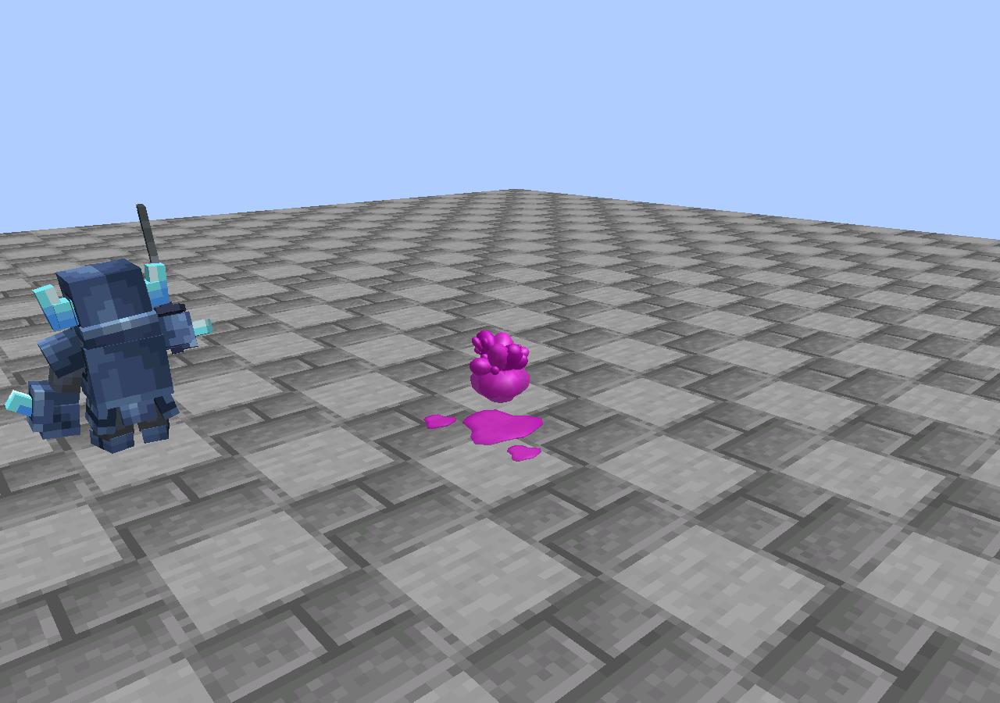
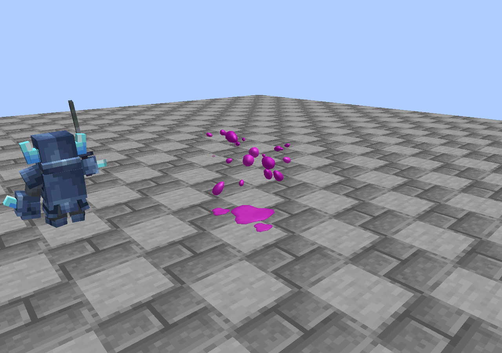
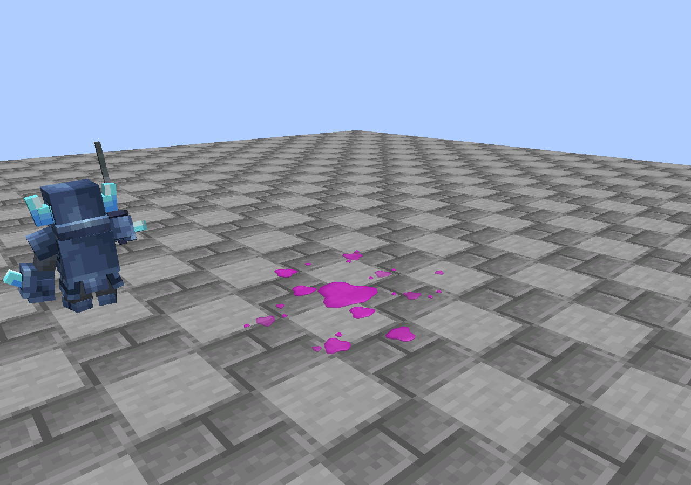
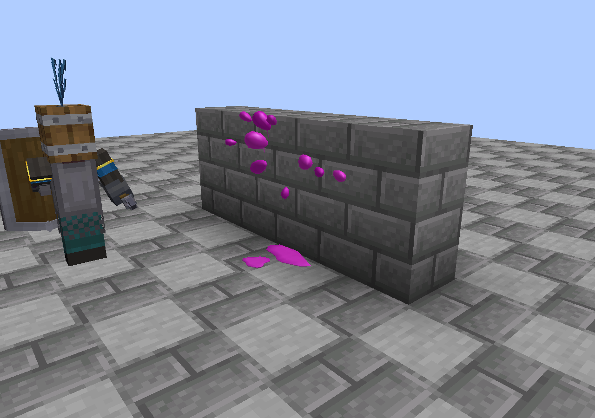

# 19 · MineClash 圣水死亡动画：源码、导入与验证

交接日期：**2026-10-12**。目标：**Minecraft 1.21.1 / NeoForge / Java 21**，实测 MineClash **0.7.5-1.21.1**、GeckoLib **4.9.2**。此章在 `main` 和 `iron-integration-1.21.1` 同步提供，**不表示 Fabric 1.20.1 已接入此效果**。

本次仅发布动画实现、可复制源码、导入资料和真实游戏截图，不生成或发布新模组 JAR，不修改已有 Beta 5 / Fabric 下载。

## 1. 从哪里拿，交付的是什么

- **[最小导入包 ZIP](downloads/mineclash-elixir-splash-import-2026-10-12.zip)**：六个效果运行时类、一个 MineClash 客户端注册类、Mixin JSON、导入说明、MIT 与素材边界。解压后 `src/main/` 可合并进 MineClash 工程。
- **[完整参考工程](examples/mineclash-elixir-splash/README.md)**：包含逐文件源码、独立开发入口、自动实机检查器与构建配置；不含第三方依赖或任何 JAR。
- **[实机验证与多视角画面](examples/mineclash-elixir-splash/docs/validation/README.md)**、[机器可读摘要](examples/mineclash-elixir-splash/docs/validation/result.json)、[资料清单与 SHA-256](elixir-vfx-manifest.json)。

动画是世界内的**程序化三维液体网格**，在游戏中实时模拟和绘制。液滴、短液丝及有厚度的残液都是几何体；无需额外贴图、shader pack、Blockbench 或 GeckoLib 动画文件。把一个 `.animation.json` 放进资源目录不能运行这套效果，需要接入下文的客户端 tick、世界渲染和死亡结束事件。

| 迸发：短液丝和液滴 | 飞散：不同速度与大小的液滴 |
| --- | --- |
|  |  |

| 落地残液 | 墙面遮挡 |
| --- | --- |
|  |  |

## 2. 原作参照与效果分段

研究了原作效果配置的公开镜像：[effects.csv](https://github.com/Lee-The-Tree/Cr_Unpacked/blob/59ef870142cef9b9dbf24ee07a05d3fd272b0e01/Unpacked_Assets/csv/effects/effects.csv)、[particle_emitters.csv](https://github.com/Lee-The-Tree/Cr_Unpacked/blob/59ef870142cef9b9dbf24ee07a05d3fd272b0e01/Unpacked_Assets/csv/particle/particle_emitters.csv)。固定 revision 为 `59ef870142cef9b9dbf24ee07a05d3fd272b0e01`；这是非官方镜像，不是 Supercell 官方发布站，也不保证与未来平衡或客户端版本完全一致。

`Death_player` 组合了 `Death_elixir_burst1`、短暂 puff/shadow 与 `Death_elixir_ground1`。飞溅发射器记录 21 滴、短促发射、约 300–1000 ms 的单滴寿命，并包含向上初速度、重力和拖尾；地面发射器记录三个残液和约 3000–4000 ms 寿命。这里据此重建三维表现，没有捆绑原作 sprite 或配置文件。

| 阶段 | 本实现 | 主要负责类 |
| --- | --- | --- |
| 原生死亡动作 | 继续播放 MineClash 自己的死亡动画、声音；服务器照常处理掉落和实体移除 | MineClash / Minecraft 原实现 |
| 迸发 | 收到死亡结束事件时生成一次；短促中心液体分开，7 条主要液丝拉断 | `SplashEffects`、`SplashRenderer`、`LiquidMesh` |
| 四散 | 初始 21 滴分布在三维空间，大小/仰角/速度不同，连续插值，头部较饱满、尾部收尖 | `Splash`、`LiquidMesh.drop` |
| 碰撞 | 用真实方块碰撞形状与流体射线检测；碰墙停止，碰地压成残液，大滴产生最多两个次级小滴 | `Splash.tick` |
| 残液 | 主残液与两小块散落，外加实际落点；避开相互重叠，不跨悬崖或悬空铺面 | `Splash.addStain`、`LiquidMesh.stain` |
| 消退 | 空中主体约一秒结束，地面约三至四秒逐渐缩小淡去；水面更快消散 | 两层生命周期 |

Minecraft 的坐标、相机、实体体型不同，因此采用体型缩放与程序几何重建，而不是把原作二维素材强制朝向摄像机。颜色是带粉色高光的紫红圣水，使用环境亮度和表面法线产生明暗；不依赖 Bloom。

## 3. 最小文件清单

包路径统一保留为 `dev.mineclash.elixirsplash`，避免手动改包后遗漏 Mixin 指向。完整参考工程的路径均以 `src/main/java/` 为起点：

| 文件 | 作用 | 必须复制 |
| --- | --- | --- |
| [SplashConfig.java](examples/mineclash-elixir-splash/src/main/java/dev/mineclash/elixirsplash/SplashConfig.java) | 开关、距离和数量上限 | 是 |
| [client/SplashEffects.java](examples/mineclash-elixir-splash/src/main/java/dev/mineclash/elixirsplash/client/SplashEffects.java) | 过滤 MineClash、死亡去重、跨世界清理、效果集合 | 是 |
| [client/Splash.java](examples/mineclash-elixir-splash/src/main/java/dev/mineclash/elixirsplash/client/Splash.java) | 弹道、重力、碰撞、次级喷溅和残液采样 | 是 |
| [client/LiquidMesh.java](examples/mineclash-elixir-splash/src/main/java/dev/mineclash/elixirsplash/client/LiquidMesh.java) | 封闭液滴、液丝、残液网格与表面着色 | 是 |
| [client/SplashRenderer.java](examples/mineclash-elixir-splash/src/main/java/dev/mineclash/elixirsplash/client/SplashRenderer.java) | 世界矩阵、部分 tick 插值、深度与透明状态 | 是 |
| [mixin/DeathPoofMixin.java](examples/mineclash-elixir-splash/src/main/java/dev/mineclash/elixirsplash/mixin/DeathPoofMixin.java) | 只替换客户端事件 60 的白色消失烟 | 是 |
| [MineClashElixirClient.java](examples/mineclash-elixir-splash/integration/MineClashElixirClient.java) | 合并进 MineClash 时的客户端初始化 | 是，放入对应 `client/` 包 |
| [elixirsplash.mixins.json](examples/mineclash-elixir-splash/src/main/resources/elixirsplash.mixins.json) | 仅 client 列表注册上述 Mixin | 是 |
| `ElixirSplash.java` | 独立预览工程的模组入口 | 不复制进 MineClash |
| `VisualTest.java` | 只由显式 JVM 测试开关启动的检查器 | 不复制进 MineClash |

效果代码没有编译依赖 MineClash 的具体实体类，也不读取 GeckoLib 骨骼。对 MineClash 的判断仅使用注册 ID 命名空间 `mineclash`，因此新加入的正常生物只要走同一死亡结束协议即可自动覆盖。

## 4. 按步骤导入 MineClash

### 4.1 复制源码与 JSON

解压最小导入包，将其中 `src/main/java/` 和 `src/main/resources/` 合并到 MineClash 对应目录。ZIP 内已经把注册类放到正确的包路径。

若从完整参考工程复制，使用第 3 节的六个类与 `integration/MineClashElixirClient.java`；**不要复制独立预览模组入口或覆盖 MineClash 的 mods.toml**。

### 4.2 注册 CLIENT 配置

在 MineClash 已有 `@Mod` 入口构造器中取得 `ModContainer container`，添加：

```java
container.registerConfig(
    net.neoforged.fml.config.ModConfig.Type.CLIENT,
    dev.mineclash.elixirsplash.SplashConfig.SPEC
);
```

若 MineClash 已经注册过一份 CLIENT 配置，可给这份配置指定独立文件名，避免同类型配置文件覆盖：

```java
container.registerConfig(
    net.neoforged.fml.config.ModConfig.Type.CLIENT,
    dev.mineclash.elixirsplash.SplashConfig.SPEC,
    "mineclash-elixir-splash-client.toml"
);
```

两种写法选一种即可。配置在模组构造期间注册，不要延迟到世界载入后。

### 4.3 注册客户端回调

导入包已经包含 `MineClashElixirClient`，通过 `@EventBusSubscriber(modid="mineclash", value=Dist.CLIENT, bus=Bus.MOD)` 的 `FMLClientSetupEvent` 注册：

```java
event.enqueueWork(() -> {
    NeoForge.EVENT_BUS.addListener(SplashEffects::tick);
    NeoForge.EVENT_BUS.addListener(SplashRenderer::render);
});
```

该适配文件经过 `verifyImport` 实际编译。若选择将两行监听注册移入现有的 MineClash 客户端初始化器，就不再复制这个适配类，防止重复 tick、重复绘制。

### 4.4 启用客户端 Mixin

在 MineClash 的 `src/main/resources/META-INF/neoforge.mods.toml` 追加：

```toml
[[mixins]]
config="elixirsplash.mixins.json"
```

保留原有的全部 `[[mixins]]` 条目。提供的 JSON 把 `DeathPoofMixin` 放在 **client** 数组中，不能移入通用 `mixins` 数组，否则专用服务器可能加载客户端类。

Mixin 注入 `LivingEntity.handleEntityEvent(byte)` 的 HEAD，仅在参数为 **60** 且 `SplashEffects.onDeathPoof(entity)` 接管时取消该分支。没有注入 `die()`、`tickDeath()`、伤害事件、AI 或任何 GeckoLib renderer。

### 4.5 核对原生死亡协议

Minecraft 的普通 `tickDeath()` 在服务器结束死亡时发送实体事件 60，然后移除实体。MineClash 电车把死亡时长延长到 40 tick，但仍然发送相同事件。因此本效果自然等到它自己的动画结束，旁边存活实体的模型不被触碰。

未来新兵种如果完全重写死亡结束流程，仍应在**服务器最终确认移除**的位置发一次：

```java
level().broadcastEntityEvent(this, (byte) 60);
remove(RemovalReason.KILLED);
```

只在原本没有发送事件 60 的自定义路径补充，不要给当前已有的路径再发一次。`/kill` 走正常死亡链；普通卸载、退出世界、活着时 `discard()` 不等同于死亡，不应人为调用圣水效果。

这里不需要新增自定义网络包。客户端接收现有服务器死亡结束事件后独立模拟液滴；各客户端形态允许有细微差别，碰撞和残液都是纯视觉，不改变任何伤害或世界状态。

### 4.6 编译和游戏检查

在 MineClash 原工程用它自己的 Gradle 配置编译。进入测试世界，生成一个小骷髅和旁边仍然存活的同类，击杀其中一只。正常结果应为：原动作结束 → 一组圣水 → 三至四秒淡去；旁边同类姿势正常。再试电车、皮卡、台阶、墙边与同时死亡。

需要命令时可以用：

```mcfunction
/summon mineclash:skeleton ~ ~ ~ {NoAI:1b}
/kill @e[type=mineclash:skeleton,distance=..6,sort=nearest,limit=1]
```

本次交接本身不提供编译后的 JAR。

## 5. 渲染与运动的关键约束

- `ClientTickEvent.Post` 每 tick 更新运动；渲染用 `previous.lerp(position, partialTick)`，运动连续性不依赖模型关键帧。
- `RenderLevelStageEvent.Stage.AFTER_LEVEL` 使用事件提供的 `modelViewMatrix`。顶点先减相机世界坐标，再转 float，避免远离原点时精度损失；**不要再额外平移负相机坐标**，否则会造成位置偏移。
- `POSITION_COLOR`、普通 alpha 混合、`LEQUAL_DEPTH_TEST`、**`COLOR_WRITE`**。透明液体不写深度，避免挡掉实体模型或造成“斩首”；地形的深度仍遮住后方液滴。
- 大滴使用带尖尾的低多边形封闭曲面，法线插值形成柔和亮暗与湿润高光；液丝是六边截面的弯曲几何。没有朝向相机的 sprite 或交叉平面。
- 地面残液由有厚度的多边形构成，每个外缘点独立检查实际碰撞表面。同一水平面上靠得太近的新残液会合并为视觉上的已有残液（跳过重叠生成），避免交错闪烁；不会把一片薄面拉伸穿过台阶立面。
- 仅每 tick 做弹道碰撞；残液边缘采样只在创建时发生，每个残液 20 个边缘点，渲染帧不做地形射线。
- `SEEN` 是弱引用集合，事件重复只播一次；离开或切换 `ClientLevel` 时清空效果和去重集合。效果不持有死者实体引用，不写 NBT，不放置圣水方块。
- 保留原始死亡声音，不叠加其它爆炸声或原版史莱姆声。

## 6. 可以调整的参数

| 参数 | 默认 | 所在位置 / 影响 |
| --- | --- | --- |
| `enabled` | `true` | `SplashConfig`；关闭后恢复原白色消失烟 |
| `maxBursts` | 24，范围 1–64 | `SplashConfig`；超出时清掉最旧的一组 |
| `renderDistance` | 48 格，范围 8–96 | `SplashConfig`；死亡事件接收时的距离筛选；已存在网格还有 96 格硬裁切 |
| 初始液滴 | 21 | `Splash`；7 个大滴，其余小滴 |
| 总液滴上限 | 每组 35 | 只允许大滴落地时生成两个次级滴，次级滴不再分裂 |
| 体型系数 | `clamp(sqrt(width*height)*0.78, 0.6, 1.65)` | 小兵和巨型兵种保持不同量感，防止无限放大 |
| 发射高度 | `clamp(height*0.39, 0.23, 1.05)` | 相对实体脚底 |
| 重力 | 每 tick `0.033` 格/tick 的速度改变量 | `Splash.GRAVITY`；不是服务器实体物理 |
| 大滴寿命 | 18–21 tick | 另有末尾 4 tick 淡去，碰撞可提前结束 |
| 小滴寿命 | 7–19 tick | 次级滴固定 7 tick |
| 主残液寿命 | 64–78 tick | 后约 55% 时间淡出并收缩 |
| 水面残液 | 18 tick | 不生成永久漂浮液面 |
| 整组清理 | 超过 86 tick | 防止残留对象无限增长 |

需要更小开销时优先降低 `maxBursts` / `renderDistance`。不要通过砍掉 partial tick 插值节约性能，也不要把数量改成无限制。修改 `LiquidMesh` 的色彩时保持底色、表面明暗与高光的层次，避免全部全亮。

## 7. 实际验证及边界

最终同装环境包括 MineClash、GeckoLib、Royale Spells Beta 5 和电车附属 0.1.1。九场景检查、重复事件、普通实体排除、生命周期清理与 45 只同时死亡均通过。20 种有已注册渲染器的 MineClash Mob 的真实死亡均收到效果。

上游 `super_mini_pekka` 在所测客户端未注册 renderer；枚举检查器最初生成它导致一次空指针，随后加了渲染器预检并完整重跑。该条目不计入通过结果，未改动上游代码。详见 [完整证据与限制](examples/mineclash-elixir-splash/docs/validation/README.md)。

这不是所有整合包、shader pack、多人服务器或未来 MineClash 的兼容保证。源码提供 NeoForge 1.21.1 接口，不能直接放入 Fabric 项目；移植其它加载器需重接事件与矩阵入口。

## 8. 来源和许可

本效果的自编代码、程序网格与文档采用 **MIT**，可以直接合并进 MineClash，并保留许可说明。未捆绑 Supercell 原贴图、音频、解包数据、MineClash JAR 或 GeckoLib JAR。

MineClash 本体与角色素材出处：[CurseForge / MineClash](https://www.curseforge.com/minecraft/mc-mods/mineclash)。截图中 Minecraft、MineClash 和其它第三方视觉资产不因本代码采用 MIT 而改变权利归属，详见 [素材边界](examples/mineclash-elixir-splash/ASSETS.md) 与 [LICENSE](examples/mineclash-elixir-splash/LICENSE)。
