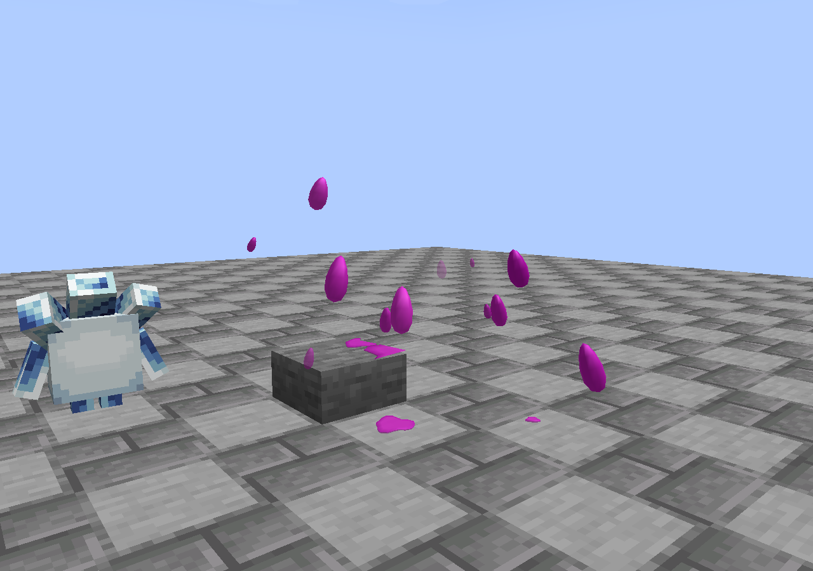
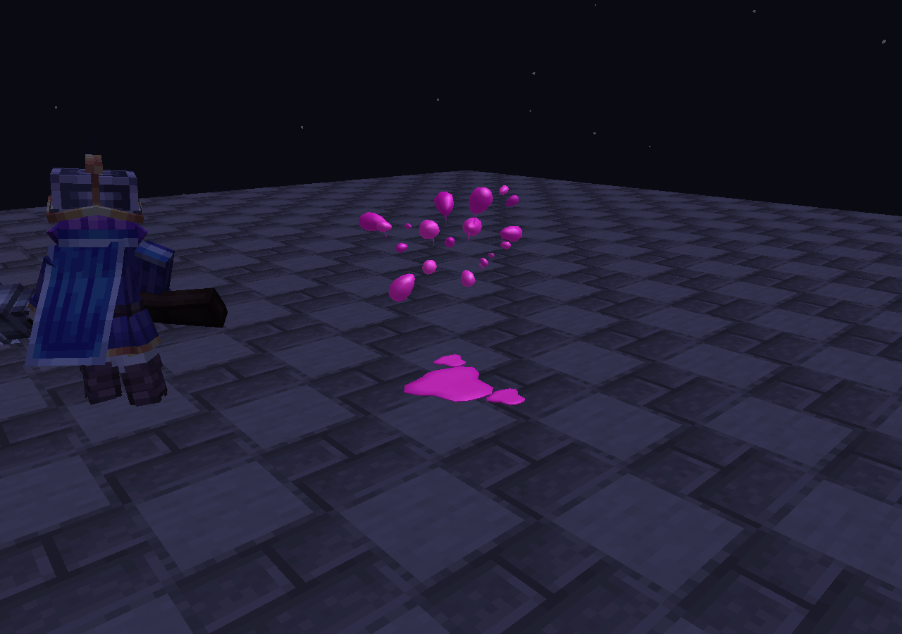
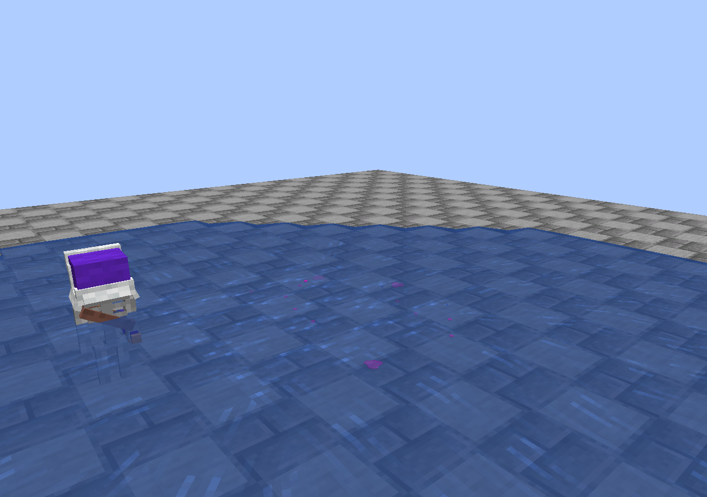
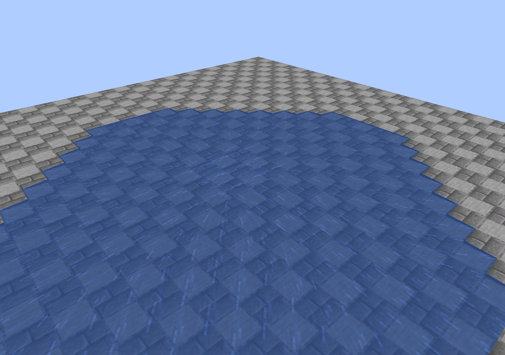

# 实机验证 · 2026-10-12

这些图片由开发客户端直接捕获，未用概念图、合成渲染或图片生成替代。验证使用独立新世界，不修改用户实例。

最终环境：Minecraft 1.21.1、NeoForge 21.1.249、Java 21.0.12、MineClash 0.7.5-1.21.1、GeckoLib 4.9.2；同时装入 Royale Spells 1.9.4-beta.5 和电车附属 0.1.1。前两轮独立使用 MineClash + GeckoLib 检查视觉，再修正棱面与残液重叠问题。

最终结果：

- 九个场景逐个通过一次死亡只出一组效果：迷你皮卡、小骷髅、电车、石人、冰精灵、皮卡、皇家卫队、夜间精英火枪手、水面小骷髅。
- 原生服务器伤害 → 死亡动作 → 客户端实体事件 60 → 圣水效果完整走通。没有用手动生成特效代替这些检查。
- 普通僵尸死亡、活着的 MineClash 实体直接 `discard()` 均没有触发。
- 额外重复事件检查通过；生命周期结束后特效列表为空。
- 45 只小骷髅同时死亡，最大同时保留 24 组，旧效果优先退场。
- 枚举 **20 种有已注册渲染器的 MineClash Mob**，收到 20 次实际死亡效果。
- 55 张阶段截图、3139 个含效果的渲染帧；局部构建/提交 CPU 时间样本 2038 个，p50 0.1811 ms、p95 0.9259 ms；峰值 40608 个四边形。

性能数值测量的是本效果渲染回调的 CPU 用时，包括几何提交，不是 GPU 时间或整帧 FPS，不能外推到所有整合包。未测试 Iris/Oculus、自定义 shader pack、Sodium/Embeddium、远程多人或其它 Minecraft 版本。

## 一个检查器发现的上游边界

第一次全注册表检查误生成了 `mineclash:super_mini_pekka`。该条目在所测 0.7.5 客户端没有注册实体渲染器，触发 `EntityRenderDispatcher.shouldRender` 空指针；之前九个场景和群体测试均已走完。检查器改为先查询真实渲染器，只生成已配置渲染器的实体，再完整重跑并通过。没有修改或声称修复这个上游条目，也没有把它算进通过的 20 种实体。效果的命名空间过滤本身不排除它：本体未来补上渲染器并发送原生死亡结束事件后即可使用。

## 画面

| 迸发 | 空中液滴 |
| --- | --- |
|  |  |

| 地面残液 | 台阶碰撞 |
| --- | --- |
|  |  |

| 墙边遮挡 | 夜间 |
| --- | --- |
|  |  |

| 水面淡去 | 45 只同时死亡 |
| --- | --- |
|  |  |

机器可读摘要见 [result.json](result.json)，提取后的原始测试标记见 [client-markers.txt](client-markers.txt)。没有上传本机完整日志、存档、第三方 JAR 或崩溃报告。
